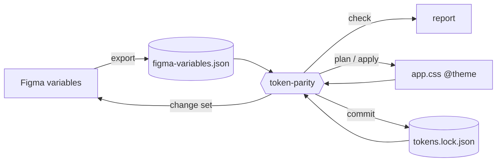

# token-parity

Keep the design tokens in Figma and in your code identical, and fix drift in either direction.

Designers change Figma variables and developers change CSS, so over time the two drift: a color nudged on
one side, a spacing value on the other, a new token that only exists in one place. token-parity finds
every difference, works out which side changed, and syncs them. When both sides changed, it asks you. It
never guesses.

- **Figma:** variables, with collections, modes (such as light and dark), aliases, scopes and code syntax.
- **Code:** Tailwind v4 `@theme` CSS, including dark-mode overrides and Tailwind's `prefix()`.
- **How you use it:** ask [Claude Code](https://claude.com/claude-code) ("sync our tokens"), or run the
  CLI yourself. CI runs `token-parity check` to catch drift in pull requests.

## Quick start

You need Claude Code with the Figma MCP connected, Node 20+, a
Tailwind v4 stylesheet with an `@theme` block, and a Figma file with at least one variable collection.

**1. Install the plugin** in Claude Code:

```
/plugin marketplace add andypyle/token-parity
/plugin install token-parity@token-parity
```

That's all: the plugin includes the engine, so there's nothing else to install.

**2. Ask Claude:**

> Check our tokens against Figma.

The first time, Claude asks for your Figma file URL, your CSS file and where to keep token files, and
writes `token-parity.config.json`. Then it reports what has drifted, and changes nothing. When you're
ready:

> Sync the design tokens.

To update later, run `/plugin` and update token-parity.

## How it works



**It compares three things, not two.** Comparing Figma with code tells you *that* they differ, not *which
side changed*. So token-parity keeps a lock file, `tokens.lock.json`, recording the state at the last
sync, and compares each side against it:

| Figma since the last sync | Code since the last sync | Result |
| --- | --- | --- |
| unchanged | unchanged | in sync |
| changed | unchanged | copy Figma → code |
| unchanged | changed | copy code → Figma |
| changed | changed | **conflict**: you decide |

**Colors match 1:1.** If Figma shows `#0000FF`, your CSS must hold exactly `#0000ff` (or `rgb(0 0 255)`),
so searching your code for the value you see in Figma finds it. One step off is drift. The right color
written differently, such as `oklch()`, is flagged so it can be rewritten. Prefer OKLCH in code? See
[Colors](#colors).

**Nothing changes without your approval.** A sync runs in separate steps: `check` reports, `plan` shows
exactly what would change, and `apply` edits your CSS. After Figma is updated, `commit` confirms Figma
really holds the new values before the lock moves. A failed push can't leave the lock claiming something
that didn't happen.

**The engine never talks to Figma.** It only reads and writes files. The Claude Code skill moves data in
and out of Figma, using code the engine generates. Every hand-off is checksummed, so a value copied wrong
is caught, never synced.

## Syncing with Claude Code

**Check** ("check our tokens against Figma") exports the Figma variables, runs `check`, and tells you
what has drifted and which way each change should go. It changes nothing. If Figma hasn't changed since
the last export, the export step costs almost nothing.

**Sync** ("sync the design tokens"):

1. Plans the sync, and asks about anything it can't decide:
   - **Conflicts:** both sides changed the same token. Keep Figma, keep code, or skip.
   - **First sync:** with no lock yet, nothing says which side is newer. Decide one by one, or pick a
     side for all of them.
   - **New Figma variables:** a name or collection, but only when it can't copy them from similar
     variables.
2. Shows the full plan and waits for your approval. Deletes need a separate yes.
3. Edits your CSS, updates Figma, confirms Figma matches, and writes the lock.
4. Runs a final `check`, and tells you what changed on each side and which files to commit.

Your answers are saved in a resolutions file, so you aren't asked the same question twice. Claude never
chooses or edits token values itself; values always come from Figma or from your code.

**What to commit:** your CSS, `tokens.lock.json`, the Figma export and the resolutions file. Add
`.token-parity/` to `.gitignore`; it only holds temporary state.

## Configuration

`token-parity.config.json` lives at your project root. Paths are relative to it. The skill writes it for
you, but here is a complete example:

```json
{
  "figmaFile": "https://www.figma.com/design/AbC123/Design-System",
  "figma": "tokens/figma-variables.json",
  "code": "src/app.css",
  "lock": "tokens/tokens.lock.json",
  "resolutions": "tokens/token-parity.resolutions.json"
}
```

| Key | What it's for |
| --- | --- |
| `figmaFile` | The Figma file to sync (used by the skill) |
| `figma` | Where the Figma export is saved. Commit it, so CI can check against it |
| `code` | Your CSS with the `@theme` block |
| `lock` | The state at the last sync. Commit it |
| `resolutions` | Your answers to questions token-parity can't decide (created when needed) |

Optional settings:

| Key | What it does |
| --- | --- |
| `ignore` | Tokens to leave alone, by CSS name or Figma name, with `*` wildcards: `["animate-*", "dark/*"]`. Add `:mode` to ignore one mode only: `"color-amber-*:dark"` |
| `modes` | CSS selectors for each mode, e.g. `{ "dark": [".dark"] }`. Default: `.dark`, `[data-theme="dark"]` and `@variant dark` |
| `prefix` | Your Tailwind prefix, if `@import "tailwindcss" prefix(…)` is in a different file from `code` |
| `colorMatch` | `"exact"` (default) or `"perceptual"`. See [Colors](#colors) |
| `colorFormat` | How colors are written into CSS: `"preserve"` (default), `"hex"`, `"rgb"`, or `"oklch"` (perceptual only) |
| `figmaCollection` | Default Figma collection for new single-mode variables, when it can't be inferred |
| `nearThreshold`, `rgbTolerance`, `precision`, `remBase` | Fine-tuning for perceptual matching and units (defaults: 0.005, 0.5/255, `{l:4,c:4,h:2}`, 16px) |

## How tokens are matched

### Names

A Figma variable is linked to a CSS token by, in order:

1. **Its code syntax** (`codeSyntax.WEB`, set in Figma's variable editor and shown in Dev Mode).
   `var(--color-primary)` links to `--color-primary`. Classes like `bg-primary`, `p-4` or `rounded-md`, Sass
   `$color-primary`, and `theme.colors.primary` work too, as long as they point at exactly one token in your
   CSS. Expressions (`calc(…)`) and literals (`2px`) aren't names.
2. **The last sync.** The lock remembers each variable's Figma ID, so renaming a variable in Figma doesn't
   break the link.
3. **Its name.** `color/brand/primary` in Figma matches `--color-brand-primary` in CSS.

**New Figma variables** created from code are named, scoped and grouped like their closest existing
neighbor. For example, `--color-brand-secondary` next to `Color/Brand Primary` becomes `Color/Brand
Secondary`, in the same collection. They also get their code syntax set, so developers see the right name
in Dev Mode. If there's nothing similar to copy, you're asked for a name.

### Modes

Values in `@theme` are each Figma collection's first mode (usually Light). Overrides in `.dark` (or your
configured selectors) are the matching Figma mode. Reports always call the base mode `default`, and other
modes keep their names (`dark`).

A Figma collection with a single mode, such as a set of primitives, has no dark mode. A dark override of
one of its tokens in code is reported as exactly that, rather than as a value mismatch.

### Colors

By default (`colorMatch: "exact"`), a color in code must be the same 8-bit value Figma shows, written as hex
or `rgb()`. One step off is drift. The same color written another way is a `format-mismatch`, and a sync
rewrites it. Values written to Figma are exact, so Figma then shows the hex that's in your code.

With `colorFormat: "preserve"` (the default), each value keeps the format it has: hex stays hex, legacy
`rgba(…, …)` stays legacy. New tokens use whichever format your file uses most.

**Prefer OKLCH in code?** Set `"colorMatch": "perceptual"`. Colors are then compared by how different they
look (ΔE in OKLab), and tiny rounding differences count as a `near-match`, not drift.

Exact matching needs an sRGB Figma file, which new files are. Display P3 files fall back to perceptual
matching, with a warning.

### Aliases, `color-mix()` and computed values

- **Aliases compare by the value they resolve to.** Figma `{gray/50}` against code `#f9fafb` is in sync if
  `gray/50` is that color. Code aliases resolve the way the browser does: in dark mode,
  `var(--color-gray-100)` picks up a `.dark` override of `--color-gray-100`.
- **Different alias targets with the same value** are an `alias-mismatch`. For example, Figma's Dark
  points at `{dark/background}` while code moved to `var(--color-gray-950)`. A sync can re-alias Figma,
  creating `gray/950` first if needed. It only proposes an alias that gives the right value in that mode;
  otherwise it writes the value and tells you why.
- **`color-mix()`** is evaluated, so `color-mix(in srgb, var(--color-gray-900) 50%, transparent)` compares
  as that color at 50% opacity. Supported spaces are `srgb`, `srgb-linear`, `oklab` and `oklch`. Other forms
  are reported as "can't evaluate".
- **Computed spacing.** Tailwind derives spacing steps from one `--spacing`. A Figma variable with code
  syntax `calc(var(--spacing) * 4)` is checked against 4 × `--spacing`.

### Tailwind prefix

With `@import "tailwindcss" prefix(tw)`, Tailwind emits `--tw-color-primary`, and your CSS has to use that
name in `var()` references and dark overrides. token-parity reads both the prefixed and the plain form, and
always writes the prefixed name, so nothing it writes points at a variable that doesn't exist at runtime.
Namespace resets like `--color-*: initial` are ignored.

### Units

Figma numbers are pixels, so `1rem` in CSS equals `16` in Figma (change it with `remBase`). When a value
comes from Figma, the unit already used in your CSS is kept.

## Using the CLI

The skill runs these for you. You can also run them yourself, provided you can export Figma variables.
The engine is a single file with no dependencies, `skills/token-parity/bin/token-parity.mjs` in this repo,
run with `node` (an npm package is on the [roadmap](#roadmap)):

```sh
alias token-parity="node /path/to/token-parity.mjs"
token-parity check                                # report drift; exits 1 if there is any
token-parity plan [--prefer code|figma]           # show what a sync would change
token-parity apply [--allow-deletes]              # edit your CSS, prepare Figma's changes
token-parity commit --figma <fresh export>        # after Figma is updated: write the lock
```

With a config file no flags are needed. Every setting can also be passed as a flag (`--figma`, `--code`,
`--lock`, `--ignore`, `--color-match`, …). Run `token-parity --help` for the full list.

### What `check` reports

```
# token-parity check

**Drift found:** 3 errors, 0 warnings.

| Token | Mode | Kind | Suggested | Details |
| --- | --- | --- | --- | --- |
| `color-blue-500` | default | value-mismatch | Figma → code | Figma changed since the last sync: … |
| `color-red-500` | default | conflict | needs decision | Changed on both sides since the last sync: … |
| `spacing-4` | default | value-mismatch | code → Figma | Code changed since the last sync: code 1.25rem, Figma 16. |
```

| Finding | Meaning |
| --- | --- |
| `value-mismatch` | The values differ. One side changed, or there's no lock yet to tell which |
| `conflict` | Both sides changed, differently. You decide |
| `missing-in-code` / `missing-in-figma` | Only one side has the token: new there, or deleted on the other side |
| `missing-mode` | A mode, such as dark, exists on one side only |
| `alias-mismatch` | Same value, but each side aliases a different variable |
| `format-mismatch` | The right color, but not written as hex or `rgb()` |
| `broken-alias` | An alias points nowhere, loops, or has the wrong type |
| `out-of-gamut` (warning) | The code color can't be shown in Figma's color profile |
| `near-match` (info) | Colors differ only by rounding (perceptual matching only) |

Use `--format json` for machine-readable output.

### Deciding what `plan` can't

`plan` lists anything it can't decide, with a hint. Put your answers in the resolutions file and run
`plan` again:

```json
{
  "version": 1,
  "resolutions": { "color-red-500:default": "figma", "color-legacy:*": "skip" },
  "names": { "radius-md": "Corner/Medium" },
  "collections": { "radius-md": "Primitives" }
}
```

Keys are `token:mode` exactly as `plan` shows them (`*` for the whole token). `"figma"` or `"code"` says
which side wins, and `"skip"` leaves it alone. `--prefer code|figma` settles every first-sync difference at
once, but never a conflict.

`apply` refuses to run if anything changed since `plan`. It edits only the declarations the plan names, so
your formatting and comments stay as they are. Deletes only run with `--allow-deletes`.

### Exit codes

| Command | 0 | 1 | 2 |
| --- | --- | --- | --- |
| `check` | in sync (warnings allowed) | drift | usage or input error |
| `plan` | everything has an action | decisions remain | usage or input error |
| `apply` | applied | | stale plan or error |
| `commit` | lock written | changes not in Figma yet (nothing lost) | error |

## In CI

CI can't reach Figma, so it checks your code against the last committed Figma export. Someone who edits a
token in CSS without syncing gets a failing check that names the tokens.

```yaml
# .github/workflows/tokens.yml
name: tokens
on: [pull_request]
jobs:
  check:
    runs-on: ubuntu-latest
    steps:
      - uses: actions/checkout@v4
      - uses: actions/setup-node@v4
        with: { node-version: 20 }
      - run: curl -fsSL -o token-parity.mjs https://raw.githubusercontent.com/andypyle/token-parity/v0.1.0/skills/token-parity/bin/token-parity.mjs
      - run: node token-parity.mjs check
```

The engine is one self-contained file, so CI downloads it from a release tag. Pin the tag, so CI only
changes when you choose to upgrade.

## Limitations

- **Code:** Tailwind v4 `@theme` CSS only.
- **Figma:** local variables only. Aliases to variables from a published library show as broken aliases.
- **By hand:** changing a token's type, adding a mode to a Figma collection, and removing a single mode's
  value are left for you to do in Figma or code.
- **Large syncs:** one sync can push about 300 changes to Figma. For more, skip part of the plan and sync the
  rest afterwards.

## Roadmap

- **More code formats:** plain CSS custom properties, Sass, W3C design tokens (DTCG) JSON, and JS/TS theme
  objects. Each is an adapter into the same shared format, so checking, planning and the lock work the same.
- **Figma as the only source of truth:** a one-way mode for teams where designers own the system. Code
  changes are reported as drift to undo, and CI fails on token edits made in code. The skill would only
  ever read Figma.
- **Publishing to npm:** `npm install -D token-parity` for using the CLI without Claude Code, and for CI.
- **Larger syncs:** split big change sets across several pushes automatically, keeping the same safety
  checks.
- **Library variables:** read variables from published Figma libraries, so aliases to them compare like
  any other token.
- **OKLCH, once Figma supports it:** exact matching for `oklch()`, and for Display P3 files.

## Development

```
packages/core/                       the engine and CLI (TypeScript, ESM, Vitest, tsdown)
skills/token-parity/                 the Claude Code skill
skills/token-parity/bin/             the engine bundled into one file (generated by pnpm build; committed)
.claude-plugin/                      the plugin and marketplace manifests
docs/                                design notes
```

`pnpm build` also rebuilds the plugin's bundled engine. Commit it with your change; CI fails if it's out of
date. To try the plugin from a checkout without installing it, run `claude --plugin-dir /path/to/token-parity`.

```sh
pnpm install
pnpm test          # unit tests, fixtures, and write-then-read checks across generated project shapes
pnpm typecheck
pnpm build
```

CI runs all three on every pull request. Background and design decisions:
[kickoff brief](docs/kickoff-prompt.md), [plan, apply and commit](docs/phase-2-design.md),
[the skill and Figma bridge](docs/phase-3-design.md).
