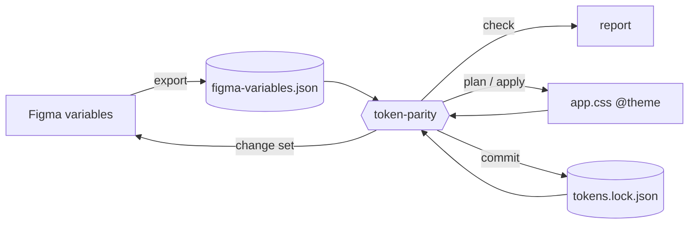

# token-parity

Keep design tokens in Figma and in code the same, and fix drift in either direction when they aren't.

Designers change Figma variables and developers change CSS. Over time the two drift apart: a blue is
nudged in one place, a spacing value changes in the other, a new token lands on only one side.
token-parity finds every difference, works out which side changed, and syncs them. It never guesses when
both sides changed.

- **Figma side:** Figma variables, including collections, modes (light/dark), aliases and scopes.
- **Code side:** Tailwind v4 CSS: `@theme` variables with colors in `oklch()`, including dark mode
  overrides.
- **Tools:** a CLI that runs anywhere, including CI, and a Claude Code skill that talks to Figma for you.

## How it works



**Three sources, not two.** Comparing Figma with code tells you *that* they differ, not *which side
changed*. The lock file, `tokens.lock.json`, records the state at the last sync. Each side is compared
against it:

| Figma vs lock | Code vs lock | Result |
| --- | --- | --- |
| same | same | in sync |
| changed | same | copy Figma → code |
| same | changed | copy code → Figma |
| changed | changed | **conflict**: you decide, it never auto-resolves |

**Colors are compared as colors, not strings.** Code can use `oklch()`, hex or `rgb()`; Figma stores RGB.
Colors are compared by
perceptual distance (ΔE in OKLab). A tiny difference from hex rounding counts as a *near-match*, not drift.
The lock keeps the original OKLCH next to the RGB written to Figma. While Figma's RGB is unchanged, the
locked OKLCH is used as-is, so a color never slowly drifts from repeated conversion. A color that Figma's
color profile can't show (out of gamut) is a warning, and the report gives the closest color Figma can
hold.

**Check, plan, apply, commit are separate steps.** `check` only reports, and is what CI runs. `plan`
says exactly what would change. `apply` makes the code edits. `commit` confirms that Figma really holds
the new values before the lock moves. A failed or half-finished push can't leave the lock claiming
something that never happened.

**The engine never talks to Figma.** It reads and writes files. Getting data in and out of Figma is the
job of the Claude Code skill. The skill runs code that the engine generates, through the Figma MCP. Every
transfer is checksummed in both directions, so a corrupted value is caught instead of synced.

## Getting started

### Requirements

- Node 20+
- A Tailwind v4 stylesheet with an `@theme` block
- A Figma file with at least one variable collection (new tokens from code are added to existing collections)
- For syncing with Figma: [Claude Code](https://claude.com/claude-code) with the Figma MCP connected

### Install

token-parity isn't on npm yet. Build it from this repo and add it to your project:

```sh
git clone https://github.com/andypyle/token-parity.git && cd token-parity
pnpm install && pnpm build
cd /path/to/your-project
npm install -D /path/to/token-parity/packages/core   # provides `npx token-parity`
```

To use the skill, copy it into your project (or into `~/.claude/skills/` for all projects):

```sh
mkdir -p .claude/skills && cp -R /path/to/token-parity/skills/token-parity .claude/skills/
```

### Configure

Create `token-parity.config.json` at your project root. With the skill, you can skip this: on first use it
asks three questions and writes the file for you.

```json
{
  "figmaFile": "https://www.figma.com/design/AbC123/Design-System",
  "figma": "tokens/figma-variables.json",
  "code": "src/app.css",
  "lock": "tokens/tokens.lock.json",
  "resolutions": "tokens/token-parity.resolutions.json"
}
```

| Key | What it is |
| --- | --- |
| `figmaFile` | The Figma file to sync (used by the skill) |
| `figma` | Where the Figma export is saved. Commit it, so CI can check against it |
| `code` | Your CSS with `@theme` |
| `lock` | The last synced state. Commit it |
| `resolutions` | Your answers to questions the engine can't decide (optional until needed) |
| `modes` | Optional. CSS selectors per mode, e.g. `{ "dark": [".dark"] }` (default: `.dark`, `[data-theme="dark"]`, `@variant dark`) |
| `figmaCollection` | Optional. Default collection for new single-mode Figma variables |
| `prefix` | Optional. Tailwind prefix, if `@import "tailwindcss" prefix(…)` isn't in the `code` file |
| `colorFormat` | Optional. How colors are written into CSS: `"preserve"` (default: keep each value's format, new tokens use the file's usual one), `"oklch"`, `"hex"` or `"rgb"` |
| `ignore` | Optional. Tokens to leave alone, by CSS or Figma name: `["animate-*", "dark/*", "color-amber-*:dark"]`. `:mode` ignores just that mode |
| `nearThreshold`, `rgbTolerance`, `precision`, `remBase` | Optional comparison settings (defaults: 0.005 ΔE, 0.5/255, `{l:4,c:4,h:2}`, 16px) |

Paths are relative to the config file. Add `.token-parity/` to `.gitignore`; it holds temporary plan
and push state.

## Using it with Claude Code

Ask in plain words:

> Check our tokens against Figma.

> Sync the design tokens.

**Check** exports the Figma variables and runs `check`, then tells you what has drifted and which way
each change should go. It changes nothing. If Figma hasn't changed since the last export, the export step
costs almost nothing.

**Sync** goes further:

1. It plans the sync, then asks you about anything it can't decide:
   - **Conflicts:** both sides changed the same token. Keep Figma, keep code, or skip.
   - **First-sync differences:** there's no lock yet to say which side is newer. Decide one by one, or
     pick a side for all of them.
   - **New Figma variables:** a name and collection, only if it can't copy them from similar variables.
2. It shows the full plan and waits for your approval. Deletes need their own separate yes.
3. It edits the CSS, pushes the changes to Figma, confirms Figma matches, and writes the lock.
4. It finishes with a `check`, and tells you what changed on each side and what to commit.

Your answers are saved in the resolutions file, so you're not asked the same question twice.

Claude never chooses or edits a token value. Values come from the engine or from Figma. All code that
touches Figma is generated by the engine. Every hand-off between the two is checksummed, so a value
copied wrong is caught, never synced.

## Using the CLI

The skill drives these commands. You can also run them directly, as long as you can export Figma
variables yourself.

```sh
npx token-parity check                 # report drift; exit 1 if there is any
npx token-parity plan [--prefer code|figma] [--resolutions <file>]
npx token-parity apply [--allow-deletes]
npx token-parity commit --figma <fresh export>     # after pushing the change set to Figma
```

With a config file, no other flags are needed. Every path can be given as a flag instead
(`--figma`, `--code`, `--lock`, `--config`). Run `npx token-parity --help` for the full list.

### check

```
# token-parity check

**Drift found:** 3 errors, 0 warnings.

| Token | Mode | Kind | Suggested | Details |
| --- | --- | --- | --- | --- |
| `color-blue-500` | default | value-mismatch | Figma → code | Figma changed since the last sync: … |
| `color-red-500` | default | conflict | needs decision | Changed on both sides since the last sync: … |
| `spacing-4` | default | value-mismatch | code → Figma | Code changed since the last sync: code 1.25rem, Figma 16. |
```

Use `--format json` for machine-readable output, and `--out <file>` to write a file.

| Finding | Severity | Meaning |
| --- | --- | --- |
| `value-mismatch` | error | One side changed (or there's no lock entry to tell) |
| `conflict` | error | Both sides changed, differently |
| `missing-in-code` / `missing-in-figma` | error | Only one side has the token (new, or deleted on the other side) |
| `missing-mode` | error | A mode (e.g. dark) exists on one side only |
| `broken-alias` | error | An alias points nowhere, loops, or has the wrong type |
| `near-match` | info | Colors differ only by rounding |
| `out-of-gamut` | warning | The code color is outside Figma's color profile |

### plan, apply, commit

`plan` writes `.token-parity/plan.json` and prints each action, which side it changes, and why. Anything
it can't decide is listed with a hint. Settle it in the resolutions file, then run `plan` again:

```json
{
  "version": 1,
  "resolutions": { "color-red-500:default": "figma", "color-legacy:*": "skip" },
  "names": { "radius-md": "Corner/Medium" },
  "collections": { "radius-md": "Primitives" }
}
```

Keys are `token:mode` exactly as the plan shows them. `figma` and `code` say which side wins, and `skip`
leaves an item alone. `--prefer code|figma` settles every first-sync difference at once. It never
settles a conflict.

`apply` refuses to run if any input changed since `plan`. It edits only the declarations the plan names,
so formatting and comments are kept. If nothing needs to change in Figma, it writes the lock and you're
done. Otherwise it writes `.token-parity/figma-changes.json` and a pending lock. Deletes only run with
`--allow-deletes`.

`commit` takes a fresh Figma export (or, through the skill, the push result) and writes
`tokens.lock.json` only when every changed token is in sync.

### Exit codes

| Command | 0 | 1 | 2 |
| --- | --- | --- | --- |
| `check` | in sync (warnings allowed) | drift | usage or input error |
| `plan` | every finding has an action | decisions remain | usage or input error |
| `apply` | applied | | stale plan or error |
| `commit` | lock written | changes not in Figma yet (pending lock kept) | error |

## In CI

CI can't reach Figma, so it checks your code against the last committed export:

```yaml
# .github/workflows/tokens.yml
name: tokens
on: [pull_request]
jobs:
  check:
    runs-on: ubuntu-latest
    steps:
      - uses: actions/checkout@v4
      - uses: actions/setup-node@v4
        with: { node-version: 20 }
      - run: npm ci
      - run: npx token-parity check
```

A developer who edits `app.css` without syncing gets a failing check that names the tokens to sync.

Until token-parity is on npm, CI needs the package from a place it can reach (a vendored copy, a git
dependency or a private registry), not a local path.

## Good to know

- **Matching names.** The best link is the variable's **code syntax** (`codeSyntax.WEB`, set in Figma's
  variable editor and shown in Dev Mode). `var(--color-primary)` matches that CSS variable when your
  `@theme` has it. With a Tailwind prefix (`@import "tailwindcss" prefix(ds)`), `var(--ds-color-primary)`
  matches `--color-primary` too. Other names work when they point at exactly one token in your CSS: a
  Tailwind class like `bg-primary`, `p-4` or `rounded-md`, a Sass `$color-primary`, or
  `theme.colors.primary`. Expressions such as `calc(…)` and literals such as `2px` aren't names.
  Variables whose code syntax doesn't match fall back to their Figma name: `color/brand/primary` matches
  `--color-brand-primary`. After the first sync
  the lock also remembers each variable's Figma ID, so renaming a variable in Figma doesn't break the
  match.
- **New Figma variables** are named and scoped like the closest existing variable. For example,
  `color-brand-secondary` next to `Color/Brand Primary` becomes `Color/Brand Secondary`. If there's
  nothing similar, you're asked for a name. They also get their code syntax set (`var(--color-brand-secondary)`,
  or whatever style the file already uses), so developers see the right name in Dev Mode.
- **Modes.** `@theme` values are the first mode of each Figma collection (usually Light). Overrides in
  `.dark` (or your configured selectors) are the matching Figma mode.
  A single-mode Figma collection (often Primitives) has no dark mode, so a dark override of one of
  its tokens in code is reported as exactly that, rather than as a value mismatch.
- **Aliases vs values.** Figma `{dark/fg-1}` and code `#e9edf0` are equal if the alias resolves to that
  color, so one side using an alias and the other an inline value isn't drift. Two aliases still
  compare by what they point at.
- **Tailwind prefix.** With `prefix(ds)`, code may refer to the emitted names (`var(--ds-color-x)`,
  `[data-theme="dark"] { --ds-color-x: … }`); both are read as `--color-x`. Namespace resets like
  `--color-*: initial` are ignored.
- **Units.** Figma numbers are pixels. `1rem` in CSS equals `16` in Figma (configurable with `remBase`).
  Units already used in your CSS are kept when Figma values are written back.
- **What to commit:** your CSS, `tokens.lock.json`, the Figma export and the resolutions file. Don't
  commit `.token-parity/`.

## Limitations

- Code side: Tailwind v4 `@theme` CSS only.
- Figma side: local variables only. Aliases to library variables show as broken aliases.
- Some changes need a hand in Figma or code: changing a token's type, adding a mode to a Figma
  collection, or removing a single mode's value.
- One push can carry about 300 changes, because of the Figma MCP's code size limit. Bigger syncs go in
  batches: skip part of the plan and sync the rest afterwards.

## Roadmap

### Codebases without Tailwind

Tailwind v4 is the only code format so far, but the engine was built to take others. Each format is an
adapter that reads tokens into one shared format, so comparing, planning and the lock work the same for
all of them. Candidates:

- plain CSS custom properties (`:root { --brand: … }`)
- Sass / SCSS variables
- W3C design tokens (DTCG) JSON, such as Style Dictionary input
- JavaScript / TypeScript theme objects

Each format needs a reader (enough for `check`) and a writer, so `apply` can edit the files in place
while keeping their formatting.

### Figma as the only source of truth

In many teams the designers own the design system, and code should follow Figma, never the other way
round. A one-way mode (for example `"source": "figma"` in the config) would work like this:

- Every difference is resolved toward code. Changes made in code are reported as drift to undo, and
  never pushed to Figma.
- A token added in code but not in Figma is flagged for removal, or for a designer to add in Figma.
- CI fails when someone edits a token in code instead of in Figma, and says so.
- The skill only ever reads from Figma, so it never needs edit access to the design file.

The direction would be a setting you choose up front, not a guess. A token changed on both sides would
still be shown to you, just with Figma's value as the planned fix.

### Publishing to npm

Install with `npm install -D token-parity` instead of building from source, and run `npx token-parity
check` in CI without vendoring the package.

### Larger syncs in one go

One push carries about 300 changes today, because of the Figma MCP's code size limit. Bigger syncs would
be split into several pushes automatically. Each part would still be checked against the state Figma
should be in before it runs, so the safety checks stay the same.

### Library variables

Variables published from a Figma library show up as broken aliases today, because exports only include
the file's local variables. Library support would read them, so aliases to a shared library resolve and
compare like any other token.

## Development

```
packages/core/     the engine and CLI (TypeScript, ESM, Vitest, tsdown)
skills/token-parity/  the Claude Code skill
docs/              design notes for each phase
```

```sh
pnpm install
pnpm test        # fixtures in packages/core/test/fixtures and test/plan-fixtures
pnpm typecheck
pnpm build
```

Background and design decisions: [kickoff brief](docs/kickoff-prompt.md),
[plan / apply / commit](docs/phase-2-design.md), [the skill and Figma bridge](docs/phase-3-design.md).
